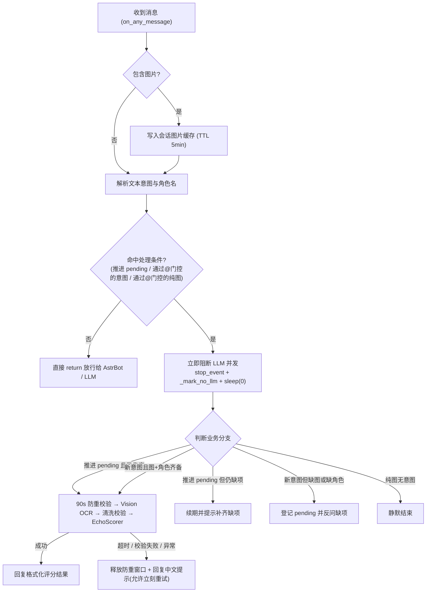

# astrbot_plugin_wuwa_echo

> 鸣潮（Wuthering Waves）声骸评分 AstrBot 插件 · **纯监听器 + 多模态 OCR · 端到端 2–4 秒**

[](https://github.com/yunyancuo/astrbot_plugin_wuwa_echo/actions/workflows/ci.yml) [](https://github.com/yunyancuo/astrbot_plugin_wuwa_echo/releases) [](https://docs.astrbot.app) [](https://www.python.org/)

发图 + 说「千咲评分」，2–4 秒拿到 ACE / SSS 评级与逐条词条强度明细。纯事件监听器架构，不走主对话 LLM 推理与 function calling，关键词命中即刻阻断并发 LLM 并秒回评分。

---

## 核心特性

- **极速秒回，零「幽灵 tail」**：命中评分后立即执行 `stop_event()` + `should_call_llm(True)` + `_has_send_oper` / `call_llm` 双保险并让出事件循环，彻底阻断主 LLM 并发响应。
- **群聊防误触门控**：群聊默认要求 `@ bot` 才响应；私聊与已登记待办的续办消息无需再 `@`；pending 等待期间无关闲聊完全放行。
- **高精度角色别名解析**：覆盖 60 位鸣潮角色与 500+ 玩家昵称/缩写/英文名，支持中点与分隔符归一化（如 `陆.赫斯` / `漂泊者 气动` / `秧秧 玄翎`）、最长优先匹配与 ASCII 词边界防误触。
- **强容错多模态 OCR**：自动过滤 COST 4 固定主词条 `攻击 150`、自动纠偏常见词条变体与 `%`/`+` 数值写法、同名去重、非有限值防护、整套坏件跳过，超时与校验失败自动释放防重窗口支持立即重试。
- **上游数据安全自动同步**：定时从 `XutheringWavesUID-Resources` 拉取新版本角色权重与别名，带 HTTPS 域名白名单防 SSRF、JSON Schema 校验与原子写盘保护，本地手工维护条目永不覆盖。

---

## 用法一览

| 你说的 | bot 回的 | 耗时 |
|---|---|---|
| *（发图）* + `千咲评分` | 单件评分结果与词条明细 | **2–4s** |
| *（发整套图）* + `维妈整套打分` | 整套总评与短板定位（昵称自动解析） | **2–4s** |
| 先发图 → 再 `@bot 评分千咲` | 自动复用 5 分钟内缓存图片评分 | **2–4s** |
| `@bot 评分今汐`（没图） → 后续单独发图 | 自动续办评分（续办无需再 `@`） | **2–4s** |
| `@bot 评分` → 补角色名 → 补截图 | 分步引导补齐，期间闲聊照常走 LLM | **2–4s** |
| *（只发图，无关键词）* | 静默缓存 5 分钟（私聊拦截 LLM，群聊未 `@` 放行） | 0s |
| `@bot 你好` / 普通闲聊 | 完全放行，走 AstrBot 默认 LLM 聊天 | — |

---

## 触发条件

**群聊默认必须 `@ bot`（或私聊）插件才会响应**——避免路人聊天里的「怎么样」「好不好」「声骸」误触发评分。补图/补角色名的续办消息无需再 `@`。

命中下面三件套触发评分：

| 要素 | 命中规则 |
|---|---|
| **强意图关键词** | 文本中出现任一即触发（不区分大小写）：`评分` `打分` `评级` `鉴定` `词条` `品质` `echo` `声骸` `声骇` `声海` |
| **弱意图关键词** | `几分` `多少分` `怎么样` `好不好` `强不强` — 较日常，需**同时带图或包含角色名**才算评分意图，否则放行给 LLM |
| **整套模式**（可选） | 额外命中：`整套` `一套` `全部` `5件` `5 件` `总评` `全套` → 走整套评分 |
| **角色名** | 60 个规范名 + 500+ 玩家昵称 / 拼音缩写 / 英文名，支持最长优先、中点/空格归一化与模糊匹配 |
| **图片** | 当前消息附带，或同会话 5 分钟内缓存过的最近图片 |

---

## 处理流程图



**为什么不走 LLM tool？**

| 路径 | 用户感知 | "幽灵 tail" | 自然语言 |
|---|---|---|---|
| `@filter.llm_tool`（v0.3.x） | 4.8s | 5–18s | ✅ |
| 当前纯监听器路径（v0.4.x+） | **2–4s** | **~0s** | ❌（关键词+昵称解析） |

LLM tool 需要主对话模型先决定是否调用工具、工具返回后再由 LLM 组织语言——一来一回 6–20 秒。纯监听器直接砍掉这层往返，速度直接砍半。

---

## 评分算法

双指标制，满分 50：

- **词条种类分（0–25）**：5 条副词条权重之和 / 满潜力 `5 × 3 = 15`，归一化到 25（钳制在 `[0, 25]`）
- **词条数值分（0–25）**：有效副词条 `(当前值 / 满级上限) × 权重` 加权平均，归一化到 25（钳制在 `[0, 25]`）
- **总分与评级一致性**：单件展示总分等于四舍五入后的分项之和，整套评级严格基于展示均分计算，消除浮点边界不一致

权重等级语义（配置于 `data/weights.json`）：

| 等级 | 含义 |
|---|---|
| **3** | 核心（暴击 / 暴击伤害 / 角色专属伤害加成） |
| **2** | 重要（攻击% / 共鸣效率 / 主技能伤害加成） |
| **1** | 次要（固定攻击 / 副技能伤害加成） |
| **0** | 无用 |

评级阈值：

| 评级 | 分数区间 |
|---|---|
| **ACE** | `≥ 45` |
| **SSS** | `≥ 35` |
| **SS**  | `≥ 25` |
| **S**   | `≥ 18` |
| **A**   | `≥ 10` |
| **N**   | `< 10` |

---

## OCR 容错与安全防护

| 场景 | 处理策略 |
|---|---|
| 误把 COST 4 固定主词条 `攻击 150` 当副词条 | 数值超过副词条满值 1.05 倍自动丢弃 |
| 模型输出变体名或带 `%`/`+` 数值（如 `暴击率`、`爆伤`、`"+9.3%"`、`{"name":"攻击","value":"9.4%"}`） | 自动清洗映射为 13 个标准副词条名，并按百分号智能纠偏 |
| 模型输出夹杂前后解释文本、markdown 代码块或尾部花括号 | 基于 `JSONDecoder.raw_decode` 精准提取首个 JSON 对象 |
| 异常数值（`NaN` / `Infinity` / `bool` / 负值）或同名重复副词条 | 自动过滤与去重，并校验 +25 声骸副词条数量严格为 5 条 |
| 整套图个别声骸模糊或模型多输出 | 宽容跳过坏件（最多保留 5 件有效声骸），全部失败才报错 |
| OCR 超时 / 校验失败 / provider 异常 | 主动超时中断并**立即释放 90s 防重窗口**，支持立刻重发重试；日志自动脱敏 API Key 与 URL Token |
| 上游同步安全与完整性 | HTTPS 域名白名单 + 重定向防 SSRF + 响应体大小上限 + JSON Schema 校验 + 原子写盘（`.bak` 备份）+ 并发目录锁 |

---

## 数据来源与自动同步

| 数据 | 来源 | 更新方式 |
|---|---|---|
| 核心角色副词条权重 | [anyul.cn](https://www.anyul.cn) (2026-05 快照) | 手工维护，永不覆盖 |
| 新角色权重 + 全量别名 | [XutheringWavesUID-Resources](https://cnb.cool/loping151/XutheringWavesUID-Resources) (CNB 国内直连主源) | **自动同步 + 原子热重载** |
| 图片 OCR | 你在 AstrBot 配置的多模态视觉 provider | 实时识别副词条 |

插件启动后及每 24 小时（可配）自动拉取上游角色别名表与 `calc.json`，数据变更后自动热重载无需重启。同步模块为纯 Python 标准库实现，支持独立命令行运行：

```bash
python core/sync.py --data-dir data --check   # 仅检查差异，不写入本地文件
python core/sync.py --data-dir data           # 执行同步并原子落盘
```

**推荐视觉 provider**：

| Provider | 模型 | 速度 | 价格参考 |
|---|---|---|---|
| **SiliconFlow** ⭐ | `Qwen/Qwen3-VL-8B-Instruct` | 1.5–3s | 新户赠送免费额度 |
| 阿里云百炼 | `qwen-vl-plus` | 2–5s | ~¥0.003/张 |
| 智谱 | `glm-4.6v-flash` | 2–8s | 免费 |

---

## 安装

### 方式 A · WebUI 直装（推荐）

AstrBot WebUI → 插件管理 → 安装插件 → 粘贴仓库 URL：

```text
https://github.com/yunyancuo/astrbot_plugin_wuwa_echo
```

> 国内服务器若拉不动 GitHub，可换反代链接：`https://gh-proxy.com/https://github.com/yunyancuo/astrbot_plugin_wuwa_echo`

### 方式 B · 服务器手动克隆

```bash
docker exec astrbot bash -c "cd /AstrBot/data/plugins && \
  git clone https://gh-proxy.com/https://github.com/yunyancuo/astrbot_plugin_wuwa_echo.git"
docker restart astrbot
```

---

## 配置项说明（`_conf_schema.json`）

在 AstrBot WebUI → 插件管理 → `astrbot_plugin_wuwa_echo` → 配置中调整：

| 配置项 | 类型 | 默认值 | 安全约束 / 说明 |
|---|---|---|---|
| `default_character` | `string` | `"generic_crit"` | 未匹配角色时使用的默认权重模板，对应 `data/weights.json` 中的 `characters` 键 |
| `vision_provider_id` | `string` | `""` | 指定专门用于声骸 OCR 的多模态 provider ID（如 `siliconflow/Qwen/Qwen3-VL-8B-Instruct`）；留空则回落当前默认 provider |
| `vision_timeout_sec` | `int` | `45` | 视觉识别超时秒数（最低安全下限 `5` 秒，非法/非正值自动回落默认 `45`） |
| `group_require_at` | `bool` | `true` | 群聊是否必须 `@ bot` 才响应（私聊不受影响）；关闭后群聊任何命中关键词的消息都会触发 |
| `auto_sync` | `bool` | `true` | 是否开启上游角色权重与别名自动同步 |
| `sync_interval_hours` | `int` | `24` | 上游数据同步周期（小时，最低安全下限 `1` 小时，防止高频死循环请求） |
| `show_substat_breakdown` | `bool` | `true` | 评分结果中是否逐条展示有效副词条星级与数值明细 |

> ⚠️ `vision_provider_id` **必须**指向支持图片输入的多模态模型；指向纯文本模型（如 DeepSeek 文本版）会返回 400 错误。
>
> 查看 AstrBot 中已配置 provider 的真实 ID：
> ```bash
> docker exec astrbot python3 -c "import json;d=json.load(open('/AstrBot/data/cmd_config.json',encoding='utf-8-sig'));[print(p.get('id')) for p in d.get('provider',[])]"
> ```

---

## 自定义角色与别名

### 新增或微调角色权重

编辑 `data/weights.json` 的 `characters` 字段：

```json
"我家角色": {
  "_desc": "重击型主C",
  "_source": "anyul.cn",
  "暴击": 3, "暴击伤害": 3,
  "重击伤害加成": 3,
  "攻击%": 2, "攻击": 1,
  "共鸣技能伤害加成": 2,
  "共鸣解放伤害加成": 1,
  "共鸣效率": 0, "普攻伤害加成": 0,
  "生命%": 0, "防御%": 0, "生命": 0, "防御": 0
}
```

### 添加自定义昵称

编辑 `data/aliases.json`（自动同步做并集合并，本地自定义昵称永久保留）：

```json
"今汐": ["今汐", "jx", "xx", "汐汐", "龙女", "你起的新昵称"]
```

修改后在 WebUI 点击「重载插件」即可生效。

---

## 目录结构

```text
astrbot_plugin_wuwa_echo/
├── main.py                     # 插件事件监听器入口、LLM 阻断与数据同步循环
├── metadata.yaml               # AstrBot 插件元数据
├── _conf_schema.json           # AstrBot 插件 WebUI 配置 Schema
├── requirements.txt            # 运行时依赖 (pydantic>=2.0)
├── pyproject.toml              # Ruff 静态检查与 Pytest 测试配置
├── .github/workflows/ci.yml    # GitHub Actions CI (Python 3.10-3.12)
├── core/
│   ├── __init__.py             # 核心包导出
│   ├── models.py               # Pydantic 数据模型与有限值校验
│   ├── ocr.py                  # Vision OCR 调用、JSON 提取与副词条容错清洗
│   ├── resolver.py             # 角色规范名/别名/归一化/词边界提取引擎
│   ├── scorer.py               # 双指标声骸评分核心
│   └── sync.py                 # 上游数据安全自动同步 (可独立运行)
├── data/
│   ├── weights.json            # 角色权重 + 副词条上限 + 评级阈值
│   └── aliases.json            # 角色规范名 → 别名映射表
└── tests/
    ├── test_data_integrity.py  # 数据文件、交叉引用与配置 Schema 校验测试
    ├── test_resolver.py        # 别名解析、最长匹配与词边界防误触测试
    ├── test_scorer.py          # 评分数学精度、边界与异常输入测试
    ├── test_ocr.py             # OCR 提取、容错纠偏、超时与脱敏测试
    ├── test_sync.py            # 离线 Mock 同步、SSRF 防护与原子写盘测试
    └── test_main.py            # Mock AstrBot 路由、@门控、LLM 阻断与重试测试
```

---

## 开发与测试指南

本仓库提供纯离线可运行的单元测试套件与静态代码检查配置（支持 Python 3.10–3.12）：

```bash
# 安装运行与开发依赖
pip install -r requirements.txt pytest ruff PyYAML

# 代码规范与潜在缺陷检查
ruff check .

# 运行完整离线单元测试套件
pytest -v
```

---

## 已知限制

- 多模态识别精度取决于所选 vision provider，建议 **7B 参数起步**
- 主词条与套装合鸣效果暂不计入评分（声骸品质差异主要由 5 条副词条决定）
- 仅支持 **+25 满级**声骸（5 条副词条），未满级声骸会触发副词条不足提示

---

## 版本历史

| 版本 | 关键变化 |
|---|---|
| **v0.6.0** ⭐ | 新角色零维护：接入 XutheringWavesUID-Resources 自动同步上游新角色评分权重与别名，本地手工条目永不覆盖，拉取失败回落本地快照；`core/sync.py` 可独立运行 |
| v0.5.0 | 群聊强制 `@` 门控；pending 期间不再吞无关闲聊；弱意图词需配图/角色名；整套宽容解析；OCR 超时保护与防重复评分；`default_character` 生效 |
| v0.4.3 | 设置 `_has_send_oper` + `call_llm` 标志彻底阻断 LLM 阶段，幽灵 tail 清零 |
| v0.4.2 | `stop_event` 后 `asyncio.sleep(0)` 让出 tick |
| v0.4.1 | `stop_event` 提前到 OCR 之前 |
| v0.4.0 | 移除 LLM tool，纯事件监听器架构 |
| v0.3.x | `@filter.llm_tool` 路径（用户感知 5s，tail 5–18s） |
| v0.2.0 | 50 角色权重 + 500+ 昵称 |
| v0.1.0 | 初版，4 个通用模板 |

---

## 致谢

- 角色权重 · [anyul.cn](https://www.anyul.cn)
- 角色昵称与上游权重数据源 · [loping151/XutheringWavesUID](https://github.com/loping151/XutheringWavesUID)
- AstrBot 框架 · [AstrBotDevs/AstrBot](https://github.com/AstrBotDevs/AstrBot)

## License

MIT
